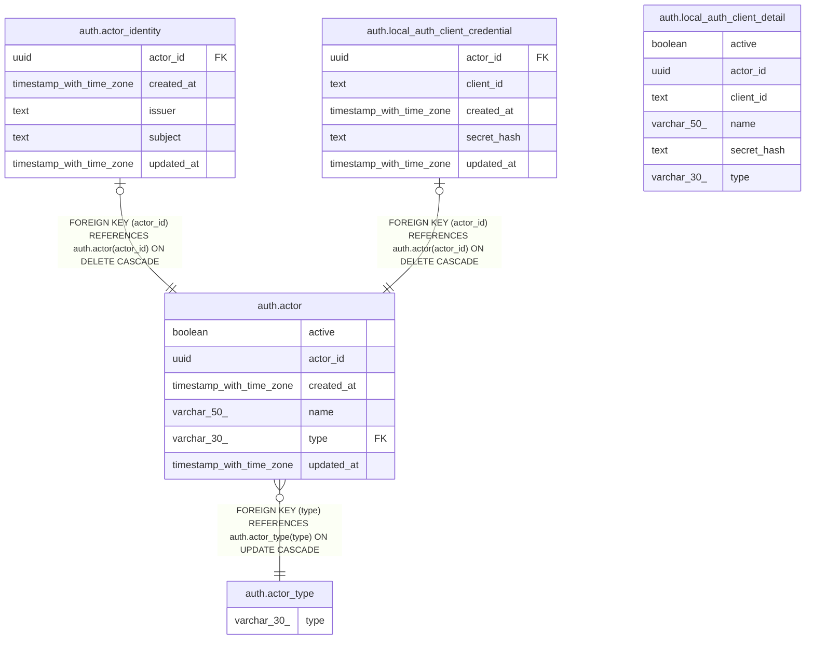

# jobdeck-auth

## Tables

| Name | Columns | Comment | Type |
| ---- | ------- | ------- | ---- |
| [auth.actor](auth.actor.md) | 6 |  | BASE TABLE |
| [auth.actor_identity](auth.actor_identity.md) | 5 |  | BASE TABLE |
| [auth.actor_type](auth.actor_type.md) | 1 |  | BASE TABLE |
| [auth.local_auth_client_credential](auth.local_auth_client_credential.md) | 5 |  | BASE TABLE |
| [auth.local_auth_client_detail](auth.local_auth_client_detail.md) | 6 |  | VIEW |

## Stored procedures and functions

| Name | ReturnType | Arguments | Type |
| ---- | ------- | ------- | ---- |
| auth.update_updated_at_column | trigger |  | FUNCTION |

## Relations

---

> Generated by [tbls](https://github.com/k1LoW/tbls)
