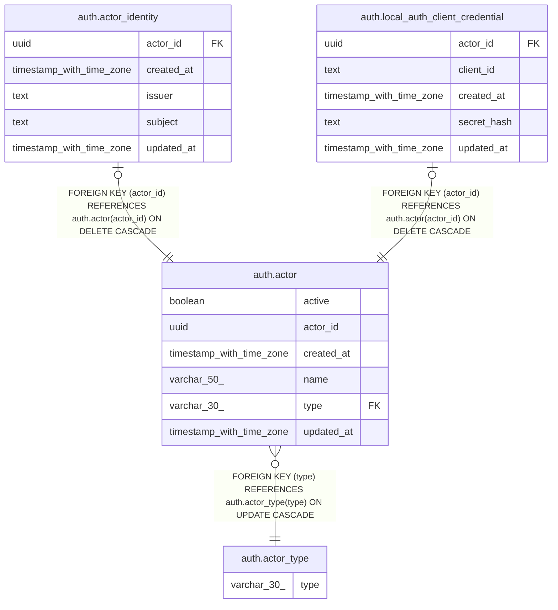

# auth.actor

## Columns

| Name | Type | Default | Nullable | Children | Parents | Comment |
| ---- | ---- | ------- | -------- | -------- | ------- | ------- |
| active | boolean | true | false |  |  |  |
| actor_id | uuid | uuidv7() | false | [auth.actor_identity](auth.actor_identity.md) [auth.local_auth_client_credential](auth.local_auth_client_credential.md) |  |  |
| created_at | timestamp with time zone | now() | false |  |  |  |
| name | varchar(50) |  | false |  |  |  |
| type | varchar(30) |  | false |  | [auth.actor_type](auth.actor_type.md) |  |
| updated_at | timestamp with time zone | now() | false |  |  |  |

## Constraints

| Name | Type | Definition |
| ---- | ---- | ---------- |
| actor_active_not_null | n | NOT NULL active |
| actor_actor_id_not_null | n | NOT NULL actor_id |
| actor_created_at_not_null | n | NOT NULL created_at |
| actor_name_not_null | n | NOT NULL name |
| actor_pkey | PRIMARY KEY | PRIMARY KEY (actor_id) |
| actor_type_not_null | n | NOT NULL type |
| actor_updated_at_not_null | n | NOT NULL updated_at |
| fk_type | FOREIGN KEY | FOREIGN KEY (type) REFERENCES auth.actor_type(type) ON UPDATE CASCADE |

## Indexes

| Name | Definition |
| ---- | ---------- |
| actor_pkey | CREATE UNIQUE INDEX actor_pkey ON auth.actor USING btree (actor_id) |

## Triggers

| Name | Definition |
| ---- | ---------- |
| actor_updated_at | CREATE TRIGGER actor_updated_at BEFORE UPDATE ON auth.actor FOR EACH ROW EXECUTE FUNCTION auth.update_updated_at_column() |

## Relations

---

> Generated by [tbls](https://github.com/k1LoW/tbls)
