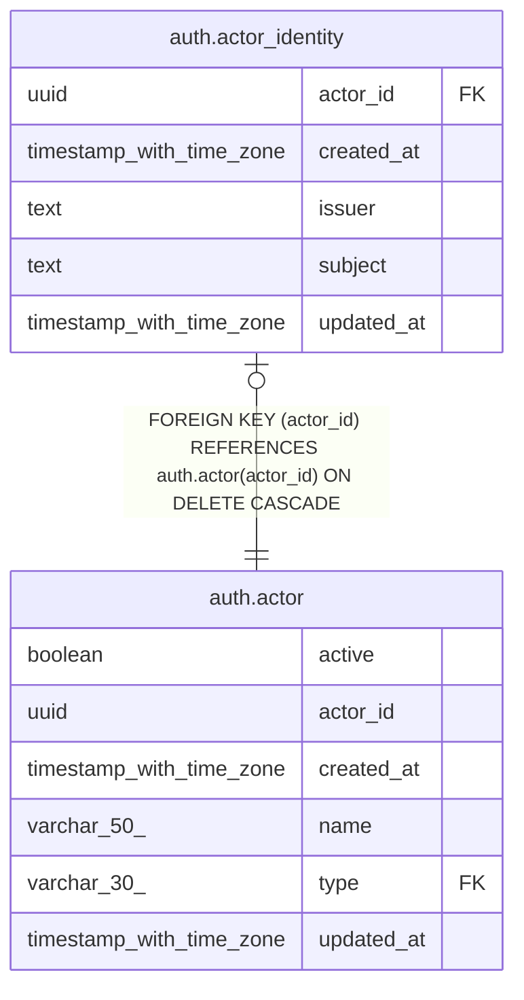

# auth.actor_identity

## Columns

| Name | Type | Default | Nullable | Children | Parents | Comment |
| ---- | ---- | ------- | -------- | -------- | ------- | ------- |
| actor_id | uuid |  | false |  | [auth.actor](auth.actor.md) |  |
| created_at | timestamp with time zone | now() | false |  |  |  |
| issuer | text |  | false |  |  |  |
| subject | text |  | false |  |  |  |
| updated_at | timestamp with time zone | now() | false |  |  |  |

## Constraints

| Name | Type | Definition |
| ---- | ---- | ---------- |
| actor_identity_actor_id_not_null | n | NOT NULL actor_id |
| actor_identity_created_at_not_null | n | NOT NULL created_at |
| actor_identity_issuer_not_null | n | NOT NULL issuer |
| actor_identity_pkey | PRIMARY KEY | PRIMARY KEY (actor_id) |
| actor_identity_subject_not_null | n | NOT NULL subject |
| actor_identity_updated_at_not_null | n | NOT NULL updated_at |
| fk_actor_id | FOREIGN KEY | FOREIGN KEY (actor_id) REFERENCES auth.actor(actor_id) ON DELETE CASCADE |
| uq_issuer_subject | UNIQUE | UNIQUE (issuer, subject) |

## Indexes

| Name | Definition |
| ---- | ---------- |
| actor_identity_pkey | CREATE UNIQUE INDEX actor_identity_pkey ON auth.actor_identity USING btree (actor_id) |
| uq_issuer_subject | CREATE UNIQUE INDEX uq_issuer_subject ON auth.actor_identity USING btree (issuer, subject) |

## Triggers

| Name | Definition |
| ---- | ---------- |
| actor_identity_updated_at | CREATE TRIGGER actor_identity_updated_at BEFORE UPDATE ON auth.actor_identity FOR EACH ROW EXECUTE FUNCTION auth.update_updated_at_column() |

## Relations

---

> Generated by [tbls](https://github.com/k1LoW/tbls)
