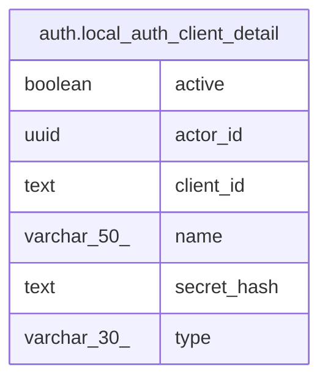

# auth.local_auth_client_detail

## Description

<details>
<summary><strong>Table Definition</strong></summary>

```sql
CREATE VIEW local_auth_client_detail AS (
 SELECT c.actor_id,
    c.client_id,
    c.secret_hash,
    a.name,
    a.type,
    a.active
   FROM (auth.local_auth_client_credential c
     JOIN auth.actor a USING (actor_id))
)
```

</details>

## Columns

| Name | Type | Default | Nullable | Children | Parents | Comment |
| ---- | ---- | ------- | -------- | -------- | ------- | ------- |
| active | boolean |  | true |  |  |  |
| actor_id | uuid |  | true |  |  |  |
| client_id | text |  | true |  |  |  |
| name | varchar(50) |  | true |  |  |  |
| secret_hash | text |  | true |  |  |  |
| type | varchar(30) |  | true |  |  |  |

## Referenced Tables

| Name | Columns | Comment | Type |
| ---- | ------- | ------- | ---- |
| [auth.local_auth_client_credential](auth.local_auth_client_credential.md) | 5 |  | BASE TABLE |
| [auth.actor](auth.actor.md) | 6 |  | BASE TABLE |

## Relations



---

> Generated by [tbls](https://github.com/k1LoW/tbls)
